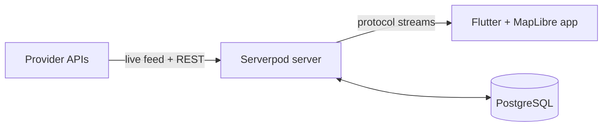

# Open Transport Map

Live map of public transit vehicles, built as a Flutter app on a Serverpod
backend. The app supports multiple public transit providers through a common
adapter interface.

The server subscribes to each provider's live vehicle feed, filters it per client
viewport, and relays it to the app as a Serverpod stream. The app renders vehicles
in a MapLibre map, lets the user search stops, and shows live departures and
journey timelines for the selected stop.

---

## Features

### Live vehicle map
- **Viewport-scoped streaming.** The client subscribes with the map bounds and
  receives only the live locations of vehicles inside them.
- **Clustered view at street level.** Below the animation zoom the map draws
  clusters, by using maplibre_gl, all vehicles can be rendered at once using the GPU
- **Animated arrows at close zoom.** When zoomed in enough
  animated arrows take over. Each arrow interpolates between its previous and
  current position with a duration derived from the reported speed ensuring a smooth animation.

### Stops, departures and journeys
- **Stop search.** Seach for stops and jump to them on the map.
- **Departures.** The selected stop shows its departures. Routes and vehicles serving the stop are drawn on the map.
- **Journey timeline.** Tapping a departure opens that journey's stops,
  with the map following the journey own vehicle live.

### View options
Settings toggle vehicle types, clustering, animations and the animation
zoom, the animated-vehicle cap, and the routes / stops / zones layers.

### Data sources
- **Scheduled sync** mirrors provider infrastructure (stops, platforms, zones)
  into a local database.
- **Lazy caching** fetches route geometry on demand the first time a stop is
  opened and reuses it.
- **Supported Providers** — Västtrafik (Gothenburg region). https://developer.vasttrafik.se/.

---

## Architecture

A Dart workspace of three packages:

| Package | Role |
| --- | --- |
| `open_transport_map_server` | Serverpod 4 server: provider adapters, sync, endpoints, auth |
| `open_transport_map_client` | Generated client. **Never edited by hand.** |
| `open_transport_map_flutter` | Flutter + MapLibre app |



Providers are plugged in through a `TransitProviderAdapter` interface (agency,
zones, stop areas, stop points, routes, and the vehicle feed) held in a registry.
The server keeps **one** upstream feed per provider, shared by every connected
client, and forwards each client only the vehicles inside its viewport. Models
are declared as `.spy.yaml` files; the rest of the server and the whole client
package are generated from them.

---

## Build and run

### Prerequisites

- Flutter 3.44.4 or newer and Dart 3.12.2 or newer
- Serverpod CLI 4.0.0: `dart pub global activate serverpod_cli 4.0.0`
- API credentials (see below)

### API keys

Västtrafik supplies the live data. You need an account to get the keys.

1. Go to https://developer.vasttrafik.se/ and create an account.
2. Create a new application in the portal.
3. Copy the client identifier and the client secret of the application.

Put the keys in `open_transport_map_server/config/passwords.yaml`, under the
`development:` section:

```yaml
development:
  vasttrafikClientId: '<your client identifier>'
  vasttrafikClientSecret: '<your client secret>'
```

`serverpod start` reads the `development:` keys. To use environment variables
instead, set `VASTTRAFIK_CLIENT_ID` and `VASTTRAFIK_CLIENT_SECRET`. The
environment takes priority over the file.

The live vehicle feed needs no keys. The stop data and the departures need them.

### Start everything

```sh
cd open_transport_map
serverpod start
```

This boots the server, applies pending migrations, and launches the Flutter app. It
watches for file changes and runs incremental code generation and hot reload on
both sides.

The app reads the server URL from `open_transport_map_flutter/assets/config.json`
(`apiUrl`), or from `--dart-define=SERVER_URL=...`. On a physical device set the
define to your machine's IP so the app can reach the server.

### Run the app on its own

```sh
cd open_transport_map_flutter
flutter run --dart-define=SERVER_URL=http://localhost:8080
```

### Build the web app

The Flutter web app is served by the server under `/`:

```sh
cd open_transport_map_server
serverpod run flutter_build
```

---

## Development

Run from the repository root unless noted.

```sh
dart analyze            # static analysis
dart format .           # formatting
cd open_transport_map_server && dart test   # tests (no Docker required)
```

After changing a model, create and apply a migration:

```sh
cd open_transport_map_server
serverpod create-migration   # add --force for destructive changes
serverpod start              # applies pending migrations on boot
```

CI (`.github/workflows`) runs analyze, format check and tests on every push and
pull request to `main`.

---

## Deployment

The server includes a `Dockerfile` and a Serverpod Cloud project config. Deploy
with:

```sh
cd open_transport_map_server
scloud deploy
```

The pre-deploy scripts run code generation and build the Flutter web app into the
server's `web/app` directory so it is served alongside the API.
